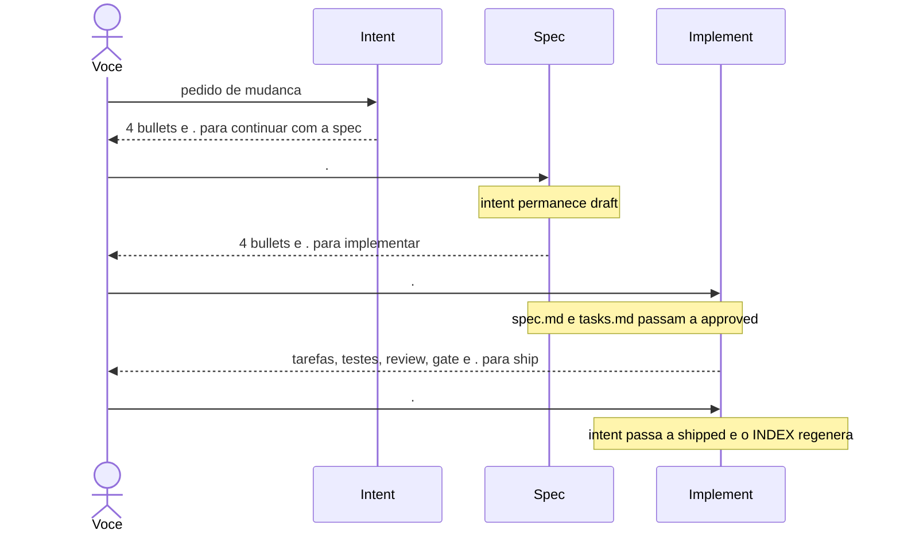
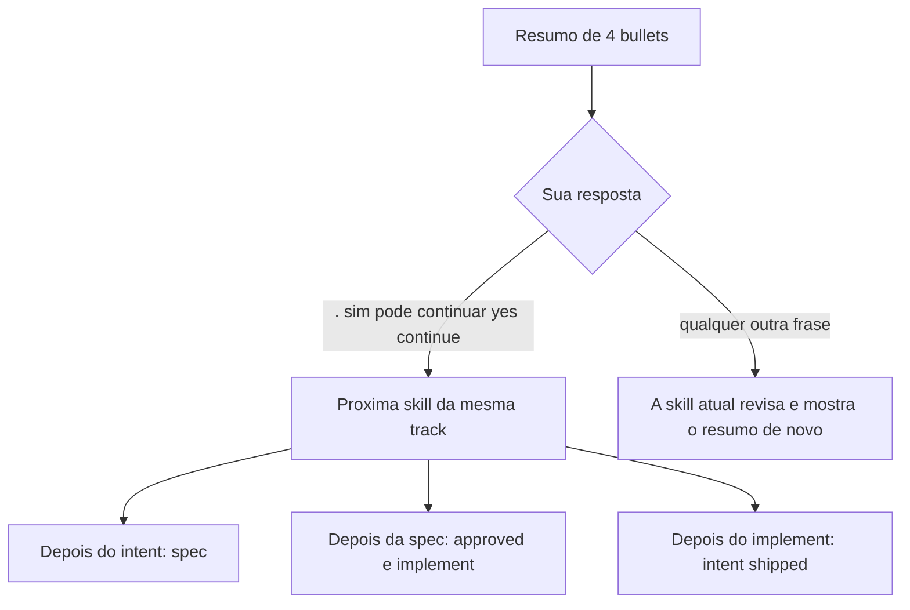
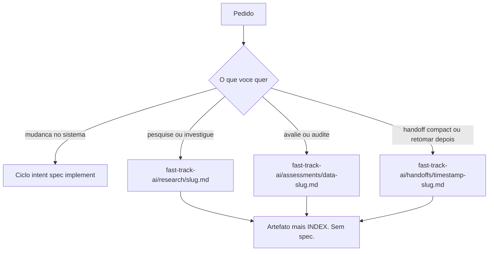
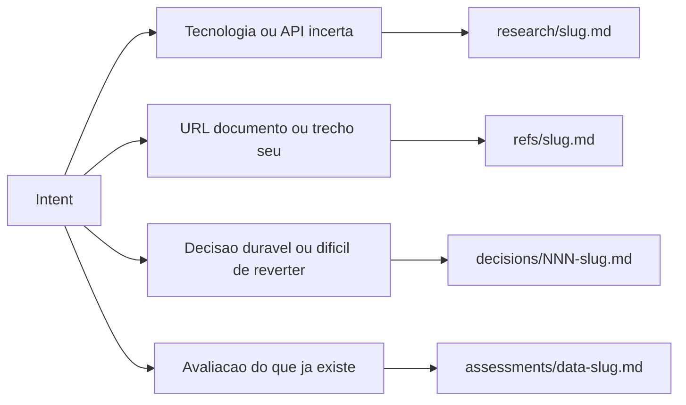
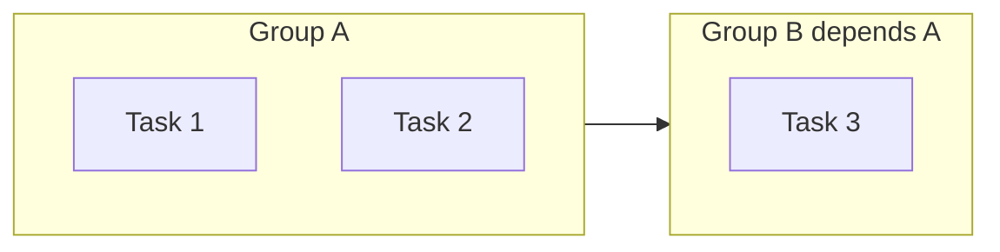
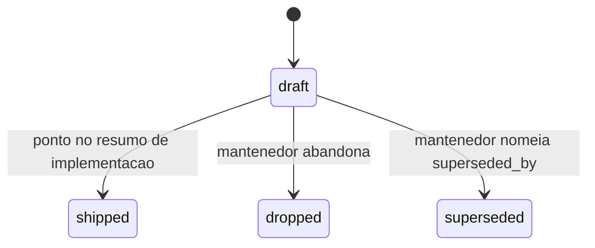

# fast-track-ai

Método leve de SDLC para agente. Um pedido de mudança vira track. A track só vira código depois de `spec.md` e `tasks.md` com `status: approved`.

Você avança o ciclo respondendo `.` no fim de cada resumo. Outra frase corrige a etapa atual e o agente mostra o resumo de novo.

## Instalar o pacote

Na raiz deste repositório:

```bash
./install.sh
```

O script é idempotente. Rode de novo: os links são refeitos, sem bloco duplicado.

| Destino | Padrão |
|---|---|
| Skills do harness | `~/.agents/skills` |
| Espelho Claude | `~/.claude/skills` |
| Comandos | `~/.claude/commands` |

Flags: `--agents-dir`, `--claude-dir`, `--commands-dir`. Se você passar só `--claude-dir`, os comandos vão para `commands/` irmão dessa pasta de skills.

Cada `commands/fast-track-ai-*.md` manda o agente executar a skill de mesmo nome em `skills/`.

## Começar num repositório

Diga ao agente: `setup fast-track-ai`, `install fast-track-ai` ou `init the method here`. A skill `fast-track-ai-init` também dispara quando a pasta `fast-track-ai/` não existe.

O script `skills/fast-track-ai-init/scripts/fast-track-ai-init.sh` cria a árvore e o bloco gerenciado em `AGENTS.md`. Em seguida `fast-track-ai-index.sh` gera `fast-track-ai/INDEX.md`.

Leia o `INDEX.md` antes de procurar track, ref, research, assessment, decision ou handoff. Ele é gerado. Edição manual se perde na próxima geração.

## Ciclo de uma mudança



1. Diga o problema, o resultado e o limite. O agente grava `fast-track-ai/tracks/NNN-slug/intent.md` com `status: draft`. Pedido vago: até 3 perguntas, cada uma dizendo o que destrava.
2. Leia os 4 bullets (problema, resultado, escopo, limites). Responda `.` para a spec, ou escreva a correção.
3. A spec grava `spec.md` (Outcome e Phases) e `tasks.md` (grupos paralelos). Os dois nascem `draft`. Pergunta aberta do intent vira trabalho na fase e na task. O agente não inventa a resposta.
4. Leia os 4 bullets (outcome, fases, quantidade de tasks, grupos). Responda `.`. Só então os dois arquivos passam a `approved` e a implementação começa.
5. A implementação lê os grupos, roda tasks do mesmo grupo em paralelo, executa o `Validate` de cada task e, no fim, o gate e a review.
6. Leia os 4 bullets (tasks, testes, review, gate). Responda `.` para `shipped`. Checkbox marcado não shipa.

O `.` depois do intent e depois da spec mantém o intent em `draft`. `shipped` só entra no passo 6.

## O que responder



Frases literais do protocolo:

- `. para continuar com a spec`
- `. para implementar`
- `. para ship (marca a track como concluida)`
- `Track concluida. Nenhuma implementacao necessaria.`

Sinônimos do ponto: `sim`, `pode continuar`, `yes`, `continue`.

## Pedido sem código



Comando explícito de research, assess ou handoff para no artefato e no index. Não cria track.

Se o pedido entrar pela skill de intent e for só investigação ou avaliação, o intent fica `draft` e a última linha é `Track concluida. Nenhuma implementacao necessaria.`

## Artefatos que entram sozinhos

Durante o intent o agente avisa em uma frase e grava, sem pedir licença:



| Artefato | Caminho | Papel |
|---|---|---|
| Ref | `fast-track-ai/refs/<slug>.md` | Fonte usada como insumo. `inline` ou `pointer`. Hash igual reusa o slug. Bytes novos exigem ref novo. |
| Research | `fast-track-ai/research/<slug>.md` | Fato externo, com fontes, conflitos e limites. Sem `status`. |
| Assessment | `fast-track-ai/assessments/<YYYY-MM-DD>-<slug>.md` | Avaliação para dentro do projeto, com evidência e contraevidência. Sem `status`. |
| Decision | `fast-track-ai/decisions/<NNN-slug>.md` | Escolha aceita. Só `accepted` ou `superseded`. |
| Handoff | `fast-track-ai/handoffs/<YYYY-MM-DD-HHmm-OFFSET>-<slug>.md` | Contexto para outra sessão. Os 3 mais novos ficam ativos. O resto vai para `handoffs/archive/`. |

No intent, cite o slug em `research:`, `refs:`, `assessments:` ou `decisions:`. Assessment não entra em `research:`.

Ref e decision não têm comando próprio. Research, assess e handoff têm.

## Grupos de tarefas



Tasks do mesmo `## Group` rodam juntas. Cada uma tem `Files` e `Validate`. Arquivos disjuntos, sem dependência de dados.

Grupo seguinte declara `(depends: Nome)` no título e espera o anterior. Na dúvida, o agente separa em grupos sequenciais. O mesmo arquivo não é editado em paralelo.

A implementação toca só os arquivos listados na spec e na task. Item em `Out of scope` fica de fora. `Assumed state` é verdade para o executor. Se faltar arquivo na lista, o agente para e pergunta.

## Status



Isso é o `status` do `intent.md`. `spec.md` e `tasks.md` usam `draft` e depois `approved` no ponto da spec.

`dropped` encerra sem implementação. `superseded` exige `superseded_by` dito por você. O agente não inventa esse campo. `active` não é status novo.

## Gate

Script: `skills/fast-track-ai-spec/scripts/fast-track-ai-gate.sh --track NNN-slug --root <repo>`.

Na spec, o gate é checagem interna. `draft` e task aberta não aparecem como falha para você.

Depois da implementação, `PASS` exige:

1. `intent.md` com `id`.
2. `spec.md` e `tasks.md` com `status: approved`.
3. `Files:` e `Accept:` na spec. `Files:` e `Validate:` nas tasks.
4. Nenhuma task `- [ ]`.
5. Sem `plan.md`. Sem arquivo solto na raiz da track.

Raiz da track: `intent.md`, `spec.md`, `tasks.md`, `decisions.md` e `assets/`. Saída auxiliar vai em `assets/`. Pasta `spec/` antiga não escolhe o ciclo.

A review olha o diff contra a spec. Severidade: `[blocking]` corrige antes de seguir, `[important]` deve corrigir, `[nit]` é opcional, `[suggestion]` é alternativa.

## Árvore deste repositório

```text
commands/                 wrappers dos 7 comandos
skills/fast-track-ai-*/   skill, template e script de cada comando
install.sh                links no harness
fast-track-ai/            memoria deste proprio repo
openspec/specs/           contrato do metodo
```

`fast-track-ai/` aqui dentro é o histórico do método aplicado a si mesmo. Num repo alvo, a mesma pasta começa vazia, só com o index.

As specs em `openspec/specs/` governam o pacote. Não são um passo do seu ciclo de feature.

- `continuous-flow`: ponto, resumo de 4 bullets, perguntas, artefatos automáticos, saída sem código.
- `method-artifacts`: ref, research, assessment, decision, handoff, index.
- `package-surface`: texto publicado, comandos instalados, status do intent.

Cada script e cada template tem uma skill dona. Outra skill aponta para a cópia da dona. Não existe pasta `shared`.

## Onde o ciclo quebra

1. Implementar com spec ou tasks em `draft`. A skill recusa.
2. Tratar o ponto do intent como aprovação. O intent segue `draft` até o ship.
3. Editar `INDEX.md` na mão.
4. Gravar `plan.md` na track. O gate falha.
5. Shipar porque os checkboxes fecharam. O ship é o ponto depois do resumo de implementação.

## Licença

MIT. Texto em [`LICENSE`](LICENSE), no modelo publicado pela Open Source Initiative.
