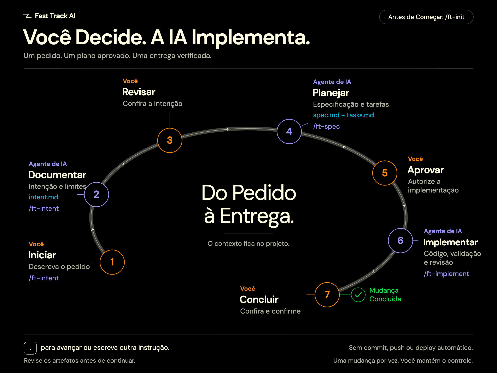
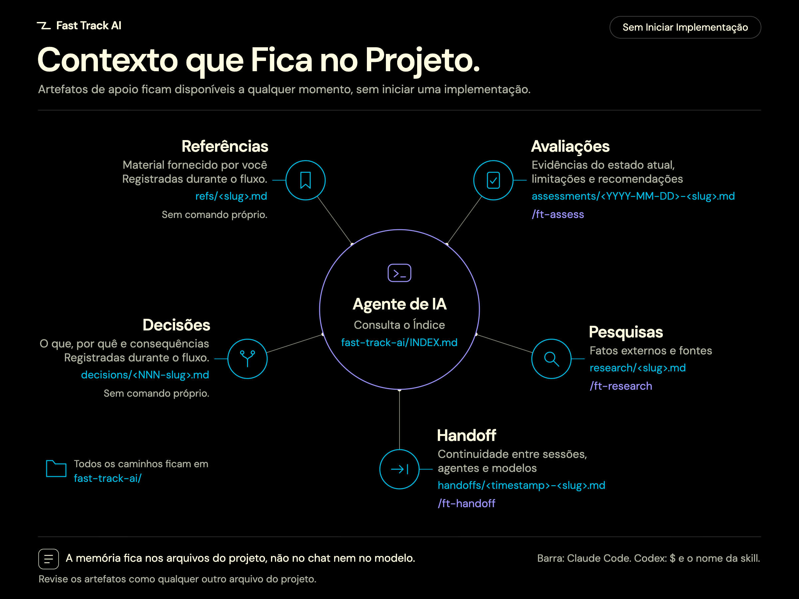

# Fast Track AI

## 1. O Que É?

O **Fast Track AI** é um framework leve de SDLC, o ciclo de desenvolvimento de software, para colocar agentes de código nos trilhos: *on track*.

Sem um processo explícito, um pedido pode virar código antes de esclarecer o que precisa mudar. O escopo fica implícito, as decisões se perdem na conversa e outra sessão precisa reconstruir o contexto.

O Fast Track organiza esse trabalho em **intenção, plano e implementação**. O agente registra o problema, o resultado esperado e os limites, prepara a especificação e as tarefas, e só implementa depois da sua aprovação. Os artefatos ficam no projeto, não apenas no chat.

Você define o rumo e revisa as entregas. O agente documenta, planeja, implementa e valida.

## 2. Como Funciona?

Depois da inicialização, cada mudança segue o fluxo abaixo. Os números mostram a sequência; os rótulos distinguem suas ações das ações do agente.



As imagens usam a chamada do [Claude Code](https://code.claude.com/docs/en/skills): `/ft-intent`. No [Codex](https://developers.openai.com/codex/skills), use `$ft-intent` ou o seletor `/skills`. Nos demais harnesses, você também pode pedir `Use a skill ft-intent para <objetivo>`.

Ao terminar uma etapa, o agente apresenta um resumo e os artefatos gerados. Você pode abri-los e revisar antes de continuar:

- **Responda `.` para avançar.** Depois do plano, isso aprova a especificação e as tarefas antes da implementação.
- **Escreva outra instrução para ajustar o rumo.** O agente trata a instrução antes de prosseguir.

A confirmação final marca a mudança como concluída. Não faz commit, push ou deploy automaticamente.

### Apoio para Preservar o Contexto

Pesquisas, avaliações e handoffs podem ser chamados a qualquer momento. Eles geram documentos que o Agente de IA consulta pelo índice do projeto, sem iniciar uma implementação.



Essa memória fica nos arquivos, não depende de o modelo lembrar de conversas anteriores. Os cinco tipos de artefato de apoio são:

| Artefato | O Que Preserva | Onde Fica |
|---|---|---|
| **Referência (`ref`)** | Material fornecido por você, como uma URL, um documento ou um trecho de código externo que fundamenta a mudança. | `fast-track-ai/refs/<slug>.md` |
| **Pesquisa (`research`)** | Fatos externos, alternativas e fontes consultadas pelo agente. | `fast-track-ai/research/<slug>.md` |
| **Avaliação (`assessment`)** | Evidências sobre o estado atual do que foi avaliado, com limitações e recomendações. | `fast-track-ai/assessments/<YYYY-MM-DD>-<slug>.md` |
| **Decisão (`decision` ou ADR)** | O que foi decidido, por quê e quais consequências a escolha traz. | `fast-track-ai/decisions/<NNN-slug>.md` |
| **Handoff** | O contexto necessário para continuar em outra sessão, agente ou modelo. | `fast-track-ai/handoffs/<timestamp>-<slug>.md` |

**Referências e decisões não têm comandos próprios.** O agente registra as referências ao preparar a intenção, quando o material fornecido fundamenta a mudança. Decisões relevantes são registradas ao longo da intenção, do planejamento ou da implementação: escolhas duradouras, difíceis de reverter ou que precisam de contexto para serem compreendidas. Não é preciso pedir um documento separado para cada uma.

## 3. Como Usar?

### Instale no Seu Projeto

Você precisa de Node.js 22.20 ou superior, `npx`, Git, Bash e um agente com suporte a skills.

Na raiz do projeto em que quer trabalhar, execute:

```bash
npx skills add jotafurtado/fast-track-ai --skill '*'
```

Instale as **sete skills**: elas usam recursos umas das outras. O [instalador de skills](https://github.com/vercel-labs/skills#install-a-skill) permite escolher os agentes; a instalação fica no projeto por padrão. Para usar em vários projetos, acrescente `--global`.

Para escolher explicitamente entre os agentes validados, use `--agent claude-code`, `--agent codex` ou `--agent kiro-cli`.

Se já usava os nomes longos, reinstale o conjunto atualizado e remova as entradas antigas do seu harness. Os comandos `ft-*` são os nomes das skills, não aliases.

### Inicialize e Faça Seu Primeiro Pedido

Abra o agente no mesmo projeto e peça:

```text
/ft-init
```

Isso prepara a pasta `fast-track-ai/`, o índice dos artefatos e as orientações em `AGENTS.md`. A inicialização pode ser repetida sem duplicar os blocos gerenciados.

Depois, inicie uma mudança com um pedido concreto:

```text
/ft-intent Adicione recuperação de senha por e-mail.
Não altere o login social.
```

A continuação com `.` aciona a próxima etapa do ciclo. Não é necessário chamar cada skill manualmente; os nomes curtos servem também para chamadas diretas.

### Skills e Ordem de Uso

| Grupo | Comando | Quando Usar |
|---|---|---|
| **Preparação** | `/ft-init` | Ao adotar o método em um projeto. Prepara a estrutura e o índice. |
| **Desenvolvimento, nesta ordem** | `/ft-intent` | Inicia cada mudança: registra problema, resultado esperado, escopo e limites. |
| | `/ft-spec` | Depois da intenção: escreve a especificação e as tarefas para sua revisão e aprovação. |
| | `/ft-implement` | Depois do plano aprovado: implementa as tarefas, valida os resultados e revisa a entrega. |
| **Apoio, a qualquer momento** | `/ft-research` | Pesquisa fatos externos, documentação ou alternativas com fontes rastreáveis. |
| | `/ft-assess` | Avalia o que já existe, com evidências, limitações e recomendações. |
| | `/ft-handoff` | Registra o contexto para continuar em outra sessão, agente ou modelo. |

As skills de apoio não precisam seguir uma ordem nem iniciar uma mudança. Por exemplo:

```text
/ft-research Investigue opções de envio de e-mail.
/ft-handoff Registre o contexto antes de encerrar.
```

No desenvolvimento, mantenha a ordem **intent → spec → implement**. Se continuar com `.`, o agente faz essas transições; você só precisa nomear uma skill quando quiser chamá-la diretamente.

### Para Aprofundar

O [guia técnico](docs/technical-guide.md) explica os artefatos, as aprovações, os grupos de tarefas e os fluxos detalhados. Os [evals e seus resultados](evals/evals.md) documentam a validação com Claude Code, Codex e Kiro.

## Licença

[MIT](LICENSE).
